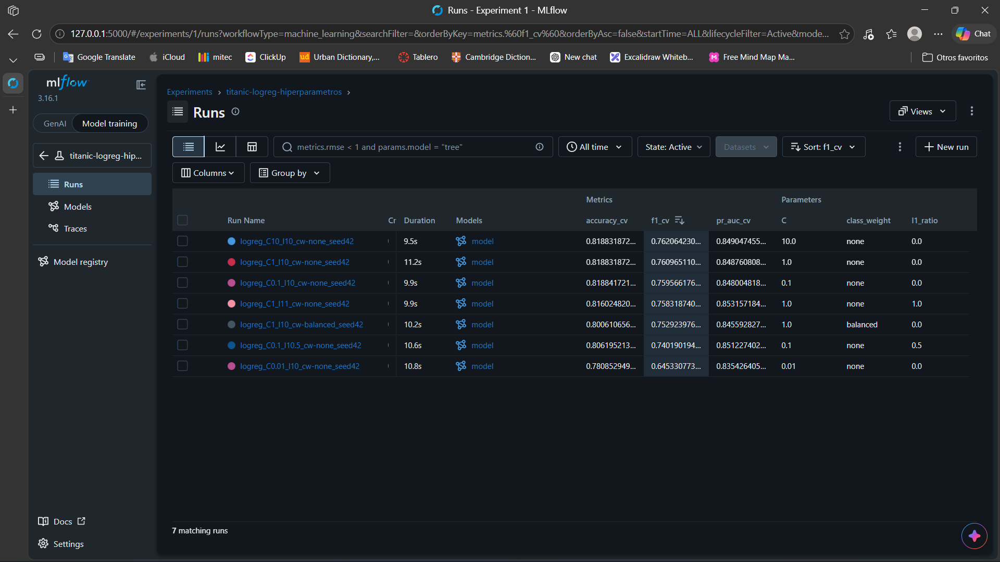
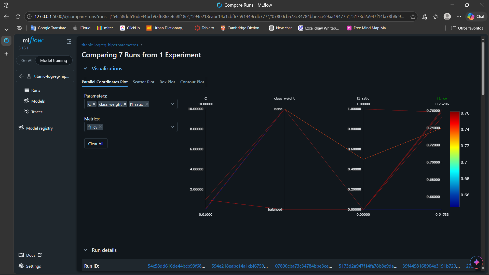

# Análisis de resultados

Se compararon siete corridas de Regresión Logística en el experimento
`titanic-logreg-hiperparametros`, todas con semilla 42 y evaluadas con
validación cruzada estratificada de 5 folds sobre el conjunto de entrenamiento
(712 registros).

| `C` | `l1_ratio` | `class_weight` | Accuracy CV | F1 CV (± std) | PR-AUC CV |
|---|---|---|---|---|---|
| 10 | 0 | none | 0.8188 | 0.7621 ± 0.023 | 0.8490 |
| 1 | 0 | none | 0.8188 | 0.7610 ± 0.019 | 0.8488 |
| 0.1 | 0 | none | 0.8188 | 0.7596 ± 0.024 | 0.8480 |
| 1 | 1 | none | 0.8160 | 0.7583 ± 0.021 | 0.8532 |
| 1 | 0 | balanced | 0.8006 | 0.7529 ± 0.041 | 0.8456 |
| 0.1 | 0.5 | none | 0.8062 | 0.7402 ± 0.032 | 0.8512 |
| 0.01 | 0 | none | 0.7809 | 0.6453 ± 0.032 | 0.8354 |

**Mejor configuración.** La corrida con `C=10`, penalización L2 y sin
ponderación de clases obtuvo el F1 más alto (0.7621), que es la métrica
principal por el desbalance de clases (38% de sobrevivientes). Sin embargo, su
ventaja sobre el baseline (`C=1`, F1 = 0.7610) es de 0.001, unas veinte veces
menor que la desviación entre folds (≈0.02), y ambas tienen el mismo accuracy.
En la práctica están empatadas, así que se conserva `C=1`: es el valor por
defecto y no hay evidencia de que relajar la regularización aporte algo.

**Hiperparámetro más influyente.** `C` fue el único que produjo un cambio mayor
que el ruido entre folds: con `C=0.01` el F1 cae de 0.76 a 0.65 y el accuracy de
0.82 a 0.78. Su efecto no es gradual: entre 0.1 y 10 el F1 varía apenas 0.003, y
el desempeño solo se degrada cuando la regularización es muy fuerte
(subajuste: el F1 en train también baja a 0.67). En cambio, `l1_ratio` y
`class_weight` movieron el F1 menos de 0.01 con `C=1`. El PR-AUC se mantuvo
entre 0.835 y 0.853 en todas las corridas, lo que indica que la capacidad de
ordenar a los pasajeros casi no cambia; lo que cambia es cuántos quedan por
encima del umbral de 0.5.

**Limitaciones.**
- Las diferencias entre las cuatro mejores corridas son menores que la desviación entre folds, por lo que el orden entre ellas no es concluyente.
- Se varió casi siempre un hiperparámetro a la vez, no una malla completa, así que las interacciones quedan sin explorar.
- Todas las corridas usan una sola semilla, y con ella una sola partición y un solo conjunto de folds de unos 142 registros cada uno.
- El F1 se calcula con el umbral fijo de 0.5; no se ajustó el umbral ni se registraron precision y recall por separado, que es donde se vería el efecto de `class_weight=balanced`.
- No se evaluó en el conjunto de prueba, que se reserva para el modelo final. Las cifras son estimaciones de validación cruzada, no desempeño final.
- El modelo es lineal: el techo de desempeño parece depender más de las variables que de los hiperparámetros.